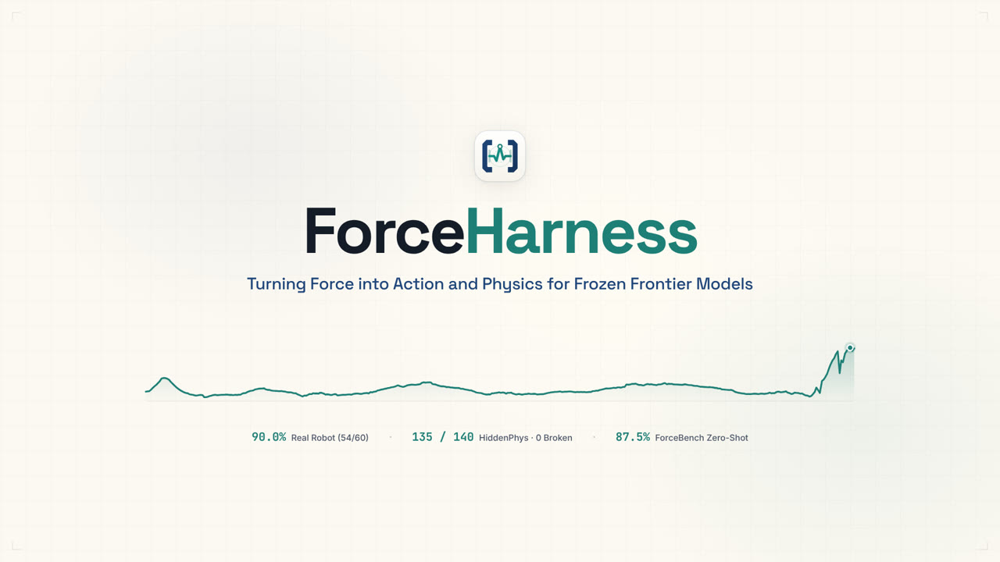
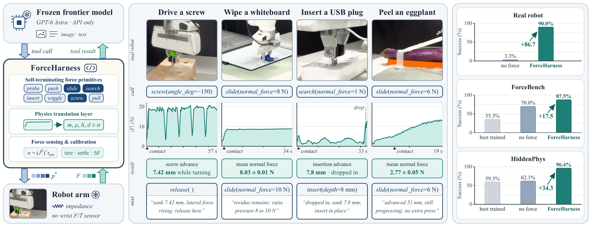
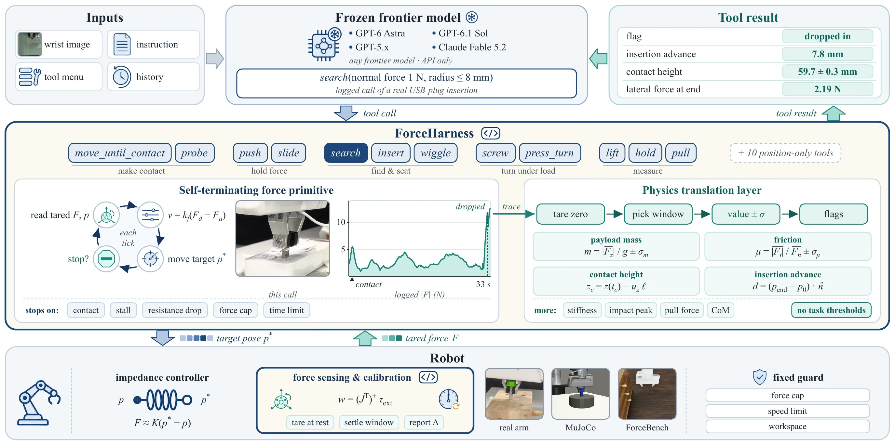

<div align="center">


<p align="center">
<a href="https://skjack.github.io/">Ke Sun</a> ·
<a href="https://kevinskwk.github.io/">Kevin Yuchen Ma</a> ·
Yike Zhang ·
<a href="https://chenanno.github.io/">Yanzhe Chen</a> ·
<a href="https://sites.google.com/view/showlab">Mike Zheng Shou</a><sup>&dagger;</sup>
</p>

<p align="center"><sup>&dagger;</sup> corresponding author</p>

**Show Lab @ National University of Singapore**

<p align="center">
📄 <a href="https://arxiv.org/abs/2611.21099">arXiv Paper</a> &nbsp;|&nbsp;
🌐 <a href="https://showlab.github.io/ForceHarness/">Project Page</a> &nbsp;|&nbsp;
🎬 <a href="https://showlab.github.io/ForceHarness/#film">Video</a> &nbsp;|&nbsp;
🤖 <a href="skills/forceharness-setup/SKILL.md">Agent Skill</a>
</p>

</div>

<p align="center">
  <a href="https://showlab.github.io/ForceHarness/#film"></a>
</p>
<p align="center"><sub>
  ▶ The project film (4:43, with narration); click to watch it on the project page. Its numbers are the paper's, so its
  ForceBench figure is on the development seeds; see Results for the held-out test.
</sub></p>

<p align="center">
  
</p>
<p align="center"><sub>
  A frozen frontier model only issues tool calls. ForceHarness calibrates hand force, runs self-terminating force primitives
  beneath the model, and returns physical quantities. Middle: four real-robot calls with their force traces and results.
  Right: GPT-6 Astra with and without force on the real robot, ForceBench and HiddenPhys, as in the paper; the ForceBench
  panel shows the development seeds 300–309, and on held-out seeds 320–329 the same code gives 62.5% → 82.5% (see Results).
</sub></p>

> [!TIP]
> **Coding agents reading this page:** clone the repository first
> (`git clone https://github.com/showlab/ForceHarness.git && cd ForceHarness`), then read [AGENTS.md](AGENTS.md) and follow
> [skills/forceharness-setup/SKILL.md](skills/forceharness-setup/SKILL.md)
> ([raw](https://raw.githubusercontent.com/showlab/ForceHarness/main/skills/forceharness-setup/SKILL.md)) before installing anything.

## Overview

ForceHarness sits between a frozen frontier model, reached only through an API, and a robot arm. The model never sees a
force stream and never runs in a control loop: it calls one tool at a time (press, slide, search, insert, screw, lift,
pull, ...), and the harness does the rest.

- **Self-terminating force primitives.** Each tool regulates contact on its own, stops on a contact event, and hands control
  back to the model.
- **Physics translation layer.** Each force trace becomes physical quantities with uncertainties (mass, friction, stiffness,
  contact height, insertion advance, ...), returned as the tool result.
- **Force sensing and calibration.** Hand force from a wrist force/torque sensor, or from joint torques alone; the real Franka
  FR3 in the paper has no wrist sensor.
- **One harness, three platforms.** The same primitives drive MuJoCo (HiddenPhys), ForceBench (Isaac Lab) and a real
  Franka FR3 under Polymetis.

All models are used zero-shot: no demonstrations, no finetuning.

## Results

<table>
  <tr>
    <th align="center" width="33%">Real Franka FR3</th>
    <th align="center" width="33%">ForceBench</th>
    <th align="center" width="33%">HiddenPhys</th>
  </tr>
  <tr>
    <td align="center"><h3>3.3% → 90.0%</h3><sub>6 tasks × 10 trials</sub></td>
    <td align="center"><h3>62.5% → 82.5%</h3><sub>8 tasks × 10 held-out seeds, RGB only</sub></td>
    <td align="center"><h3>62.1% → 96.4%</h3><sub>7 tasks × 20 seeds</sub></td>
  </tr>
</table>

Success rate of GPT-6 Astra without force (the no-force control) → with ForceHarness. In detail:

| Setting | Model | ForceHarness | No force | Reference |
|:--|:--|:-:|:-:|:--|
| Real FR3 | GPT-6&nbsp;Astra | **54/60** | 2/60 | |
| | GPT-6.1&nbsp;Sol | **47/60** | | |
| ForceBench, held-out seeds 320–329 | GPT-6&nbsp;Astra | **82.5%** | 62.5% | best trained force-aware π0.5: 35.3% |
| ForceBench, development seeds 300–309 (paper) | GPT-6&nbsp;Astra | **87.5%** | 70.0% | |
| | GPT-6.1&nbsp;Sol | **87.5%** | 65.0% | |
| HiddenPhys | GPT-6&nbsp;Astra | **135/140**, 0 damaged | 87/140 | expert force controller: 136/140<br>trained policies: 65–83/140 |

Trained policies on HiddenPhys are Diffusion Policy, π0.5 and ForceVLA, each trained on 200 demonstrations per task.

**ForceBench seeds.** The ForceBench numbers in the paper (seeds 300–309) are not held out: the ForceBench tools, task
details and perception thresholds were developed on seeds 300–307, and Stove Press and Nut Thread were revised after first
model runs on seeds 300–309. We therefore treat 300–309 as development seeds and report a separate test on seeds 320–329,
which no run had used before, with the released code unchanged: GPT-6 Astra reaches 82.5% (66/80) with ForceHarness and 62.5%
(50/80) without force. Per seed, 22 seeds succeed only with force and 6 only without (McNemar p = 0.004), and the two revised
tasks hold up (Stove Press 10/10, Nut Thread 8/10). HiddenPhys always kept separate development seeds (9000–9019) and test
seeds (9100–9119). Per-task numbers and the list of task-specific settings: [docs/forcebench.md](docs/forcebench.md#development-and-test-seeds).

## How it works

<p align="center">
  
</p>
<p align="center"><sub>
  One logged call. The model returns a tool call, here a search during a USB-plug insertion. The harness runs it as a
  self-terminating force primitive that updates the target pose at every tick and stops on a contact event; beneath it,
  the robot's stock impedance controller turns the lead into force, and the bottom layer estimates and re-zeros the hand force.
</sub></p>

| Layer | What it does | Code |
|:--|:--|:--|
| Physics translation | fixed estimators turn a force trace into quantities ± σ, with the window and flags | [`forceharness/translation`](forceharness/translation) |
| Force primitives | one shared loop: lead → admittance → events → stop | [`forceharness/primitives`](forceharness/primitives) |
| Force sensing & calibration | wrist F/T sensor or (Jᵀ)⁺τ<sub>ext</sub>; tare at rest, settle then read, report changes; a fixed guard on force, speed and workspace | [`forceharness/backends`](forceharness/backends), [`forceharness/real`](forceharness/real), [`robot_side`](robot_side) |

## Get started

### Install

```bash
git clone https://github.com/showlab/ForceHarness.git && cd ForceHarness
python3 -m venv .venv && source .venv/bin/activate   # Python >= 3.10 (macOS: e.g. uv venv -p 3.11 .venv)
pip install -e ".[dev]"                 # core harness + offline tests
pip install -e ".[sim]"                 # + HiddenPhys (robosuite 1.5.1, mujoco 3.2.7)
python -m forceharness.doctor           # what is installed, what is missing
python -m pytest -q                     # offline tests
```

Other extras: `.[forcebench]` (then `scripts/forcebench/install.sh`, see [docs/forcebench.md](docs/forcebench.md)),
`.[real]` (see [docs/real_robot.md](docs/real_robot.md)), `.[learn]` (learned baselines, [docs/baselines.md](docs/baselines.md)),
`.[data]` (dataset export). MuJoCo renders off-screen with EGL on Linux and CGL on macOS by default (`MUJOCO_GL` overrides);
the paper's HiddenPhys episodes use no images. API keys go into `.env` (copy `.env.example`): `FH_API_KEY` for OpenAI
models, `ANTHROPIC_API_KEY` for Anthropic models.

### Quick start

```bash
# 0. No simulator, no key: the expert controller on the offline fake backend
python scripts/run_episode.py --task weight_sort --agent scripted --backend fake

# 1. Check the simulator: force-sign test + one expert episode per task, no API key
python scripts/check_sim.py

# 2. One episode of ForceHarness (phys2|force) with a frozen model, under the paper's protocol (costs API credit)
python scripts/run_episode.py --task weight_sort --model gpt-6-astra --provider openai-responses \
    --reasoning-effort low --paper-defaults --seed 9100

# 3. The same episode as the no-force control (none|pose)
python scripts/run_episode.py --task weight_sort --model gpt-6-astra --provider openai-responses \
    --reasoning-effort low --paper-defaults --fmt none --interface pose --seed 9100

# 4. A paper result: ForceHarness and the no-force control with GPT-6 Astra on all 7 tasks, 20 seeds each
python scripts/run_matrix.py --matrix configs/hiddenphys/forceharness_astra.yaml --dry-run
python scripts/run_matrix.py --matrix configs/hiddenphys/forceharness_astra.yaml --workers 8 --out runs
python scripts/hiddenphys/compare_table.py --runs runs
```

Each episode writes `runs/<run>/transcripts/<episode_id>/` (the full conversation, every tool result, the force trace of every
primitive); `run_matrix.py` also appends one line per episode to `runs/<run>/results.jsonl`. See
[docs/reproduce.md](docs/reproduce.md) for every table of the paper.

### Let your coding agent set it up

The setup is packaged as an agent skill, [skills/forceharness-setup](skills/forceharness-setup/SKILL.md): plain Markdown
with a short YAML header, so any coding agent can follow it, and agents that load skills from a folder can use the
directory as is. [AGENTS.md](AGENTS.md) points agents to it. Paste this into the coding agent you use, on the machine that
will run ForceHarness, and fill in your target:

```text
Set up ForceHarness for me: clone https://github.com/showlab/ForceHarness, read its AGENTS.md,
and follow the setup skill in skills/forceharness-setup/SKILL.md gate by gate.
My target: the HiddenPhys simulator (or: ForceBench, or: my robot arm, <make, model, controller software>).
Report each gate to me, never move the robot without my go-ahead, and ask before any paid API call.
```

The skill walks the agent through detection and verification for a simulator or a real robot: it identifies the arm,
checks whether the arm can sense force at all and how well (and stops with a clear warning if it cannot), configures the
backend, calibrates force, and brings the robot up in stages that never move it without your explicit confirmation.

## Running on your own robot

ForceHarness needs three things from an arm: a pose-target interface with a compliant (impedance or operational-space)
controller, a force estimate at the hand (a wrist F/T sensor, or joint torques), and a way to stop safely.
The primitives only use the small contract in [forceharness/backends/base.py](forceharness/backends/base.py).
The real-robot reference implementation for a Franka FR3 under Polymetis splits into a workstation side
([forceharness/real](forceharness/real)) and a guard process on the robot PC ([robot_side/franka_polymetis](robot_side/franka_polymetis))
that talk over a small JSON-lines protocol, documented in [docs/robot_protocol.md](docs/robot_protocol.md) together with a porting guide.

<details>
<summary><b>Repository layout</b></summary>

```
forceharness/                  the Python package
  primitives/                  self-terminating force primitives (library.py), event detection, contact reports
  translation/                 estimators.py (physical quantities) + how force is shown to the model
                               (quantities.py = L1–L4, default L2 "phys2"; text.py / plot.py = ablation forms)
  agent/                       model side: API clients (OpenAI Responses, Anthropic), tool schemas, episode loop
  backends/                    base.py = the backend contract; mujoco/ (robosuite), forcebench/ (Isaac Lab policy server), fake.py
  hiddenphys/                  the HiddenPhys benchmark: 7 tasks with hidden physical variables (+ shifted variants)
  baselines/                   expert force controller, Code-as-Policies, Diffusion Policy model
  real/                        real-robot harness (workstation side): Franka FR3 backend, primitives, perception, runner
  data/                        loading recorded demonstrations
  eval/                        matrix runner, Wilson intervals, API pricing
  prompts/                     everything the model reads: system prompts and task instructions
  doctor.py                    environment checks (python -m forceharness.doctor)
robot_side/franka_polymetis/   runs on the robot's real-time PC: guard, driver, (Jᵀ)⁺τ wrench solve, JSON-lines worker
monitor/                       web GUI to run, watch, review and compare episodes (standard library only)
configs/                       hiddenphys/ (one file per paper result), forcebench/, real/ (example robot configuration)
scripts/                       run_episode.py, run_matrix.py, check_sim.py, hiddenphys/, forcebench/, baselines/, real/, data/
skills/forceharness-setup/     the setup skill for coding agents
assets/                        images for this page
docs/                          architecture, benchmark, ForceBench, real robot, robot protocol, baselines, reproduction
tests/                         offline tests (no simulator, robot or API key needed)
```

</details>

## Data

The HiddenPhys expert demonstrations used to train the learned baselines (7 tasks, about 200 successful episodes each, two
128×128 cameras, proprioception, raw wrist force, the exact controller actions and stiffness) are released on Hugging Face in two
forms: raw episodes that replay exactly in the simulator, and a LeRobot v2.1 dataset for training. The link will be added here
once the dataset is public. [scripts/data/export_hf.py](scripts/data/export_hf.py) builds both from recorded episodes; the
dataset card is [docs/dataset_card.md](docs/dataset_card.md).

## Safety

> [!WARNING]
> Real-robot code moves hardware. Keep a person at the emergency stop during every live episode. The guard limits in
> `robot_side/` and the validation in `forceharness/real/` are deliberately conservative; the model cannot change them, and you
> should only ever tighten them. Changes made for this public release to the real-robot path (configuration loading, the gripper
> interface) have not yet been re-validated on hardware; [docs/real_robot.md](docs/real_robot.md) lists them.

## Citation

```bibtex
@article{sun2026forceharness,
  title   = {ForceHarness: Turning Force into Action and Physics for Frozen Frontier Models},
  author  = {Sun, Ke and Ma, Kevin Yuchen and Zhang, Yike and Chen, Yanzhe and Shou, Mike Zheng},
  journal = {arXiv preprint arXiv:2611.21099},
  year    = {2026}
}
```

## License

MIT, see [LICENSE](LICENSE). Third-party code and assets keep their own licenses, see
[THIRD_PARTY_NOTICES.md](THIRD_PARTY_NOTICES.md).
